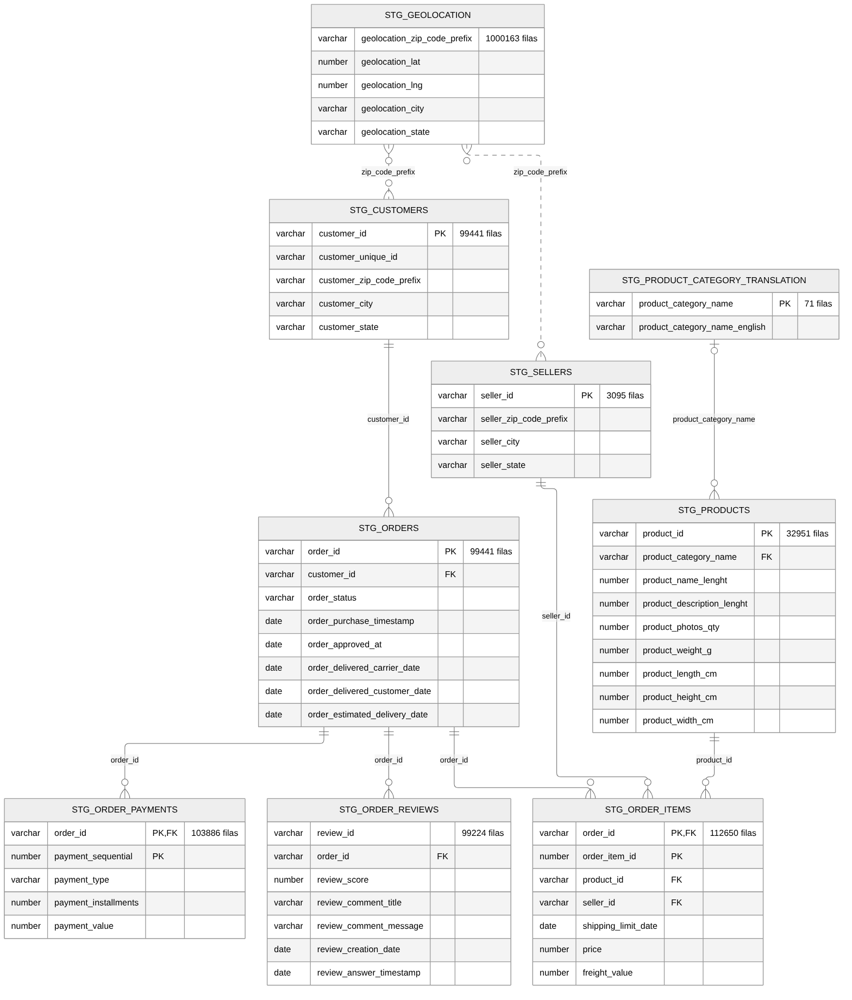

# Fuente de datos: tablas, campos y relaciones (Olist en staging)

Responsable: Joseph · Tarea 4 del enunciado (identificar fuentes, estructuras y relaciones)

La fuente es la base pública **Olist E-commerce** (Brasil, 2016-2018), cargada en el esquema de staging de cada integrante como 9 tablas `STG_*`. El ETL solo **lee** estas tablas; nunca las modifica.

> Las tablas `STG_*` no tienen claves foráneas declaradas en Oracle. Las relaciones de este diagrama se identificaron por el significado de los campos y se **comprobaron con consultas** (`sql/exploracion/01_inventario_fuente.sql` y `02_perfilado_calidad.sql`), como pide la guía del proyecto: no se asumieron solo por el nombre.
>
> El tipo de las columnas de fecha depende de cómo cada integrante importó los CSV: en unas máquinas son texto (`VARCHAR2`) y en otras `DATE`. El ETL funciona con ambos.

## Inventario

| Tabla | Filas | Una fila es… | Clave |
|---|---:|---|---|
| STG_ORDERS | 99,441 | una orden de compra | `order_id` |
| STG_ORDER_ITEMS | 112,650 | un producto (ítem) dentro de una orden | `order_id` + `order_item_id` |
| STG_ORDER_PAYMENTS | 103,886 | un pago de una orden (puede haber varios) | `order_id` + `payment_sequential` |
| STG_ORDER_REVIEWS | 99,224 | una reseña de una orden | `review_id` (no es única por sí sola) |
| STG_CUSTOMERS | 99,441 | un cliente **por orden** | `customer_id` |
| STG_SELLERS | 3,095 | un vendedor | `seller_id` |
| STG_PRODUCTS | 32,951 | un producto | `product_id` |
| STG_PRODUCT_CATEGORY_TRANSLATION | 71 | una categoría con su nombre en inglés | `product_category_name` |
| STG_GEOLOCATION | 1,000,163 | una coordenada de un código postal | ninguna (el código postal se repite) |

## Relaciones

| Desde | Hacia | Campo | Cardinalidad | Observación |
|---|---|---|---|---|
| STG_CUSTOMERS | STG_ORDERS | `customer_id` | 1 : 1 en la práctica | Olist crea un `customer_id` nuevo en cada orden. La persona real es `customer_unique_id`: 99,441 `customer_id` corresponden a **96,096 clientes reales**. Por eso `DIM_CLIENTE` se construye por `customer_unique_id`. |
| STG_ORDERS | STG_ORDER_ITEMS | `order_id` | 1 : N | 98,666 órdenes tienen ítems; las 775 restantes no tienen productos registrados. |
| STG_ORDERS | STG_ORDER_PAYMENTS | `order_id` | 1 : N | Una orden puede pagarse en varias partes (por ejemplo tarjeta + vale). |
| STG_ORDERS | STG_ORDER_REVIEWS | `order_id` | 1 : N | 99,224 reseñas corresponden a 98,673 órdenes: algunas órdenes tienen más de una. El ETL toma la más reciente. |
| STG_PRODUCTS | STG_ORDER_ITEMS | `product_id` | 1 : N | |
| STG_SELLERS | STG_ORDER_ITEMS | `seller_id` | 1 : N | El vendedor está en el ítem, no en la orden: una orden puede tener varios vendedores. |
| STG_PRODUCT_CATEGORY_TRANSLATION | STG_PRODUCTS | `product_category_name` | 0..1 : N | 610 productos no tienen categoría y algunas categorías no tienen traducción; se tratan en el ETL (`sin_categoria` y traducción manual). |
| STG_GEOLOCATION | STG_CUSTOMERS / STG_SELLERS | prefijo de código postal | N : N | Un código postal tiene muchas coordenadas. El ETL lo reduce a **19,010 códigos únicos** (coordenadas promedio) y descarta 42 filas fuera de Brasil. |

## Cómo se usa cada tabla en el DW

| Tabla de la fuente | Destino en el DW |
|---|---|
| STG_ORDER_ITEMS + STG_ORDERS + STG_ORDER_REVIEWS | `FACT_VENTAS` (un ítem por fila) |
| STG_ORDER_PAYMENTS + STG_ORDERS | `FACT_PAGOS` (un pago por fila) |
| STG_CUSTOMERS + STG_GEOLOCATION | `DIM_CLIENTE` |
| STG_SELLERS + STG_GEOLOCATION | `DIM_VENDEDOR` |
| STG_PRODUCTS + STG_PRODUCT_CATEGORY_TRANSLATION | `DIM_PRODUCTO` |
| Fechas de STG_ORDERS | `DIM_TIEMPO` |
| `order_status` | `DIM_ESTADO_ORDEN` |
| `payment_type` | `DIM_TIPO_PAGO` |
