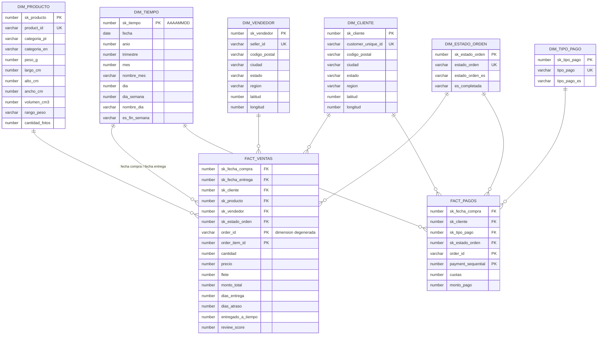

# Modelo dimensional — DW Invacom (fuente Olist)

Responsables: Joshua + Joseph · DDL: `sql/dw/01_dimensiones.sql`, `sql/dw/02_hechos.sql`

## 1. Procesos de negocio analizados

| Proceso | Tabla de hechos | Por qué separado |
|---|---|---|
| Venta de productos (qué se vende, quién lo vende, a quién, cuándo, cómo se entrega) | `FACT_VENTAS` | El precio y el flete existen por **ítem** de la orden |
| Cobro de las órdenes (cómo pagan los clientes) | `FACT_PAGOS` | El pago existe por **orden** y una orden puede tener varios pagos. Si se mezclara con los ítems, el monto pagado se repetiría por cada ítem y se **duplicaría** al sumar |

Ambas tablas comparten dimensiones (tiempo, cliente, estado de la orden): es un **esquema de constelación (galaxia) formado por dos estrellas**. No se usa copo de nieve: las jerarquías (ciudad → estado → región, día → mes → trimestre → año) se guardan desnormalizadas dentro de cada dimensión para que Excel las use directamente y las consultas tengan menos JOIN.

## 2. Granularidad

- **FACT_VENTAS:** una fila = **un ítem (unidad de producto) dentro de una orden** (`order_id` + `order_item_id`). Si una orden compra 3 unidades del mismo producto, hay 3 filas.
  Volumen esperado: 112,650 filas.
- **FACT_PAGOS:** una fila = **un pago registrado de una orden** (`order_id` + `payment_sequential`).
  Volumen esperado: 103,886 filas.

## 3. Diagrama

> GitHub dibuja este diagrama automáticamente al abrir el archivo. Para la imagen del documento APA, se puede generar con SQL Developer → *Archivo → Data Modeler → Importar → Diccionario de datos* sobre el esquema `DW_INVACOM` (ingeniería inversa del DDL).

## 4. Dimensiones

| Dimensión | Clave natural (origen) | Atributos | Fuente | Reglas principales |
|---|---|---|---|---|
| DIM_TIEMPO | fecha | año, trimestre, mes, nombre de mes, día, día de semana, fin de semana | Generada por el ETL (calendario continuo del rango de fechas de la fuente) | Clave inteligente `AAAAMMDD`; fila `-1` = "Sin fecha" |
| DIM_CLIENTE | `customer_unique_id` | código postal, ciudad, estado, **región**, latitud, longitud | STG_CUSTOMERS + STG_GEOLOCATION | Un cliente real = una fila (no `customer_id`, que cambia en cada orden). Si un cliente tiene varias direcciones, se toma la de su **orden más reciente** (SCD tipo 1) |
| DIM_VENDEDOR | `seller_id` | código postal, ciudad, estado, **región**, latitud, longitud | STG_SELLERS + STG_GEOLOCATION | Igual tratamiento de ciudad y coordenadas que clientes |
| DIM_PRODUCTO | `product_id` | categoría PT y EN, peso, medidas, **volumen**, **rango de peso**, fotos | STG_PRODUCTS + STG_PRODUCT_CATEGORY_TRANSLATION | Sin categoría → `sin_categoria`; categorías sin traducción → traducción manual documentada |
| DIM_ESTADO_ORDEN | `order_status` | estado en español, indicador de completada | Valores distintos de STG_ORDERS | Traducción al español en el ETL |
| DIM_TIPO_PAGO | `payment_type` | tipo de pago en español | Valores distintos de STG_ORDER_PAYMENTS | `not_defined` → "No definido" |

Atributos **derivados** (enriquecimiento del ETL, en negrita arriba): región de Brasil a partir del estado (Norte, Nordeste, Centro-Oeste, Sudeste, Sur), coordenadas promedio por código postal, volumen = largo × alto × ancho, rango de peso.

Todas las dimensiones tienen **clave sustituta** (`sk_*`) y un registro **`-1 "Desconocido"`**, al que apuntan los hechos cuyo producto, vendedor, cliente o fecha no se puede resolver. Así ningún hecho se pierde y la integridad referencial se mantiene.

## 5. Medidas

### FACT_VENTAS

| Medida | Fórmula | Unidad | Tipo |
|---|---|---|---|
| cantidad | 1 por fila | unidades | Aditiva |
| precio | `price` | BRL | Aditiva |
| flete | `freight_value` | BRL | Aditiva |
| monto_total | precio + flete | BRL | Aditiva |
| dias_entrega | fecha entrega al cliente − fecha de compra | días | No aditiva (promediar) |
| dias_atraso | fecha entrega al cliente − fecha estimada (negativo = llegó antes) | días | No aditiva (promediar) |
| entregado_a_tiempo | 1 si entrega ≤ estimada, 0 si no, NULL si no se entregó | indicador | Semiaditiva (sumar = cantidad a tiempo; promediar = % a tiempo) |
| review_score | puntuación 1–5 de la orden (review más reciente si hay varias) | puntos | No aditiva (promediar) |

### FACT_PAGOS

| Medida | Fórmula | Unidad | Tipo |
|---|---|---|---|
| monto_pago | `payment_value` | BRL | Aditiva |
| cuotas | `payment_installments` | cuotas | No aditiva (promediar / máximo) |

## 6. Preguntas de negocio que responde

1. ¿Cuánto se vende (monto y unidades) por **mes, trimestre y año**, y cómo evoluciona?
2. ¿Qué **categorías de producto** generan más ingresos y cuánto representa el flete sobre el precio?
3. ¿Qué **estados y regiones** de Brasil concentran las compras, y dónde están los vendedores?
4. ¿Quiénes son los **vendedores** con mayor facturación?
5. ¿Cuál es el **tiempo promedio de entrega** y el **% de entregas a tiempo** por región?
6. ¿Cómo se relaciona el **atraso en la entrega** con la **puntuación de las reseñas**?
7. ¿Qué **métodos de pago** y cuántas **cuotas** usan los clientes?

## 7. Decisiones para defender ante el jurado

- **Dos hechos y no uno:** precio/flete viven por ítem y los pagos por orden. Unirlos duplicaría el monto pagado en órdenes de varios ítems.
- **Cliente por `customer_unique_id`:** el 100 % de `customer_id` es único por orden; usarlo inflaría el número de clientes y haría imposible medir recompra.
- **`order_id` como dimensión degenerada:** permite contar órdenes distintas (`COUNT(DISTINCT order_id)`) sin crear una dimensión que no tendría atributos propios.
- **`review_score` en FACT_VENTAS:** es un dato de la orden repetido en cada ítem; por eso solo se **promedia**, nunca se suma.
- **Dimensión de tiempo con dos roles** (fecha de compra y fecha de entrega): una sola tabla de calendario sirve para analizar cuándo se compra y cuándo se entrega.
- **Estrella frente a copo de nieve:** el volumen de las dimensiones es pequeño (≤ 96 mil filas), por lo que la redundancia no pesa y se gana simplicidad para Excel.
